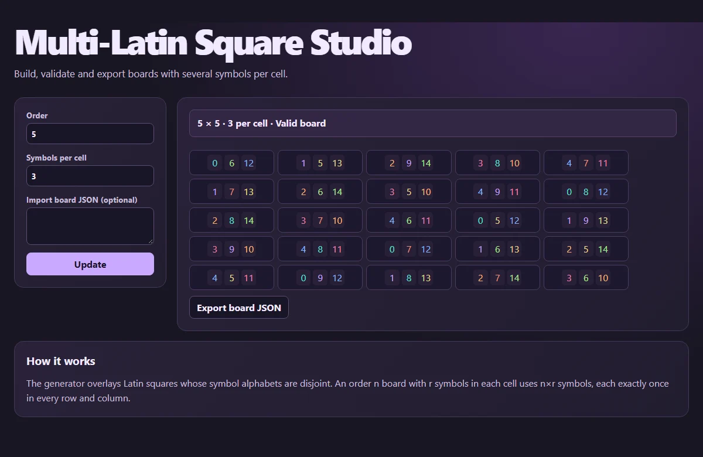

# Multi-Latin Square Studio

Build, validate and export boards with several symbols per cell.

[Open the web app](https://surfingcoder.com/apps/multi-latin-square-studio/)



## Run locally

Serve the repository with Python 3, then open http://127.0.0.1:8000/ in a current browser.

```sh
python -m http.server 8000 --bind 127.0.0.1
```

Start with the provided example. Adjust the controls and select **Update** to recompute. Sliders refresh the result as you move them.

## Method

The generator overlays Latin squares whose symbol alphabets are disjoint. An order n board with r symbols in each cell uses n×r symbols, each exactly once in every row and column.

Inspired by Michael John Harris’s graduate proseminar, *On the Existence of Transversals in r-Multi Latin Squares* (2012).

## Verify

Run `node --test check.mjs` with Node.js 22 or newer. The check runs the app’s mathematical regression cases without a browser.
